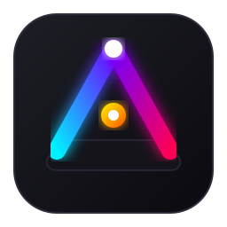

<div align="center">
  

  # AuraForge

  *Ambilight for your keyboard, fans and LED strip, synced to the screen and to League of Legends*

  [](https://www.rust-lang.org)
  [](#requirements)
  [](LICENSE)

  [Features](#features) • [Requirements](#requirements) • [Installation](#installation) • [Usage](#usage) • [Anti-cheat safety](#anti-cheat-safety)
</div>

AuraForge is a lightweight Windows daemon that reads the colors at the edges of your screen and mirrors them on a **Drevo Tyrfing V2** keyboard, on ARGB fans wired to an **ASUS Aura** motherboard, and on a **Govee** strip on your local network. During a League of Legends match it adds dedicated animations for kills, multikills, objectives and the end of the game.

It is built to stay in the background while you play games protected by kernel-level anti-cheat (e.g. Riot Vanguard): no hooks, no injection, only official APIs and write-only USB access.

## Features

- **Native screen capture**: read-only DXGI Desktop Duplication, capped at 20 FPS.
- **Cheap sampling**: only the screen borders, skipping pixels with a wide stride (`--stride`).
- **Keyboard**: single color, per-key colors, or a firmware animation with game effects on top.
- **ARGB fans**: 40 addressable LEDs through the ASUS Aura USB controller, in volatile direct mode.
- **Govee strip**: through the official LAN API (UDP), with network discovery.
- **League of Legends effects**: from Riot's Live Client Data API, animated per key and per LED.
- **System tray app**: start, stop and every setting from a menu, plus start with Windows.
- **Multithreaded**: capture, processing and each device run on separate threads, so a slow device never holds back the others.

### Game effects

| Event | Animation |
| --- | --- |
| Kill | Golden shockwave expanding from the center |
| Double / Triple / Quadra kill | Repeated waves, from orange to blood red |
| Pentakill | Rainbow on every device |
| First Blood | Crimson drips running down the keys |
| Assist | Cyan band sweeping across the keyboard |
| Death | Double red pulse |
| Infernal / Ocean / Mountain / Cloud drake | Flames / waves / rising rock / wind gusts |
| Hextech / Chemtech / Elder drake | Electric sparks / bubbles / vortex |
| Baron Nashor | Purple spiral vortex |
| Rift Herald | Magenta charges that speed up and crash |
| Turret, inhibitor, ace | Blue flashes, white waves |
| Victory / Defeat | Rainbow / red pulses |

Objectives taken by the enemy team produce a single dimmed pulse.

## Requirements

- Windows 10 or 11
- [Rust](https://rustup.rs) stable (MSVC toolchain)
- Visual Studio 2022 Build Tools with the C++ workload (used by `build.cmd`)
- At least one supported device:

| Device | Connection | ID |
| --- | --- | --- |
| Drevo Tyrfing V2 | USB HID | `0416:A0F8` |
| ASUS Aura controller (motherboard ARGB header) | USB HID | `0B05:19AF` |
| Govee strip with LAN API (e.g. H615A) | Wi-Fi, UDP 4001–4003 | — |

> [!NOTE]
> For a Govee strip, enable **LAN Control** for the device in the Govee Home app.

## Installation

```bat
git clone https://github.com/zEhmsy/AuraForge.git
cd AuraForge
build.cmd build --release
```

`build.cmd` loads the Visual Studio environment and runs `cargo`. The executables end up in `target\release`:

| File | Description |
| --- | --- |
| `AuraForge.exe` | System tray app (everyday use) |
| `auraforge-cli.exe` | Command-line daemon (debugging and scripting) |

The icon is generated at build time from [`assets/logo.svg`](assets/logo.svg).

## Usage

### Tray app

Run `AuraForge.exe`: the icon appears in the notification area (in color while running, gray while stopped). From its menu you can:

- start or stop the daemon;
- pick the keyboard mode, animated theme, color, speed and brightness;
- pick the screen to capture;
- enable the fans, the Govee strip (with **Search the network for strips**) and the League of Legends effects;
- run the effects demo, open the log and start with Windows.

Settings are stored in `%APPDATA%\AuraForge\settings.json` and the log in `%APPDATA%\AuraForge\auraforge.log`.

> [!TIP]
> **Effects demo** cycles through every animation without a match. Use it to try out your setup, but turn it off before playing.

### Command line

```bat
:: per-key colors, fans and Govee strip
auraforge-cli --per-key --fans --govee 192.168.1.50

:: keyboard on the "aurora" theme with League effects only, fans follow the screen
auraforge-cli --keyboard-idle 0AC8B9 --keyboard-theme aurora --fans --lol

:: try it out without touching any device
auraforge-cli --per-key --dry-run
```

<details>
<summary>All options</summary>

| Option | Description | Default |
| --- | --- | --- |
| `--per-key` | Color every key from the screen area above it | off |
| `--fps N` | Capture rate, 1–20 | 15 (8 with `--per-key`) |
| `--monitor N` | Monitor index across all GPUs | 0 |
| `--border PCT` | Thickness of the sampled screen border, 1–50% | 12 |
| `--stride N` | Sample every N-th pixel in each direction | 16 |
| `--boost G` | Brighten dark colors, gamma 0.2–1.0 (1.0 = off) | 0.5 |
| `--smoothing A` | Fade factor per frame, 0.05–1.0 | 0.35 |
| `--threshold N` | Minimum channel change before writing | 6 |
| `--max-reports N` | Per key: at most N packets (5 keys each) per update | 9 |
| `--brightness N` | Keyboard brightness, 0–100 | 100 |
| `--profile N` | Keyboard profile id | 1 |
| `--mode N` | Ambient lighting mode byte | 1 (static) |
| `--keyboard-idle RRGGBB` | Keyboard ignores the screen: shows this color and only the League effects | — |
| `--keyboard-theme NAME` | Firmware animation behind the League effects (needs `--keyboard-idle`): `static`, `breath`, `streamer`, `rain`, `horse-race`, `stars`, `reactive`, `waterdrop`, `cross`, `ripple`, `aurora`, `bomb`, `heatmap`, `spotlight`, `radar`, `snaking`, `convolution` | — |
| `--theme-speed N` | Animation speed byte | 2 |
| `--theme-dir N` | Direction: 0 right, 1 left, 2 down, 3 up | 0 |
| `--theme-color C` | Theme palette: `fixed`, `rainbow`, `random` | `fixed` |
| `--fans` | Also paint the ARGB fans (ASUS Aura) | off |
| `--fan-header N` | 0-based addressable header the fans hang off | 0 |
| `--fan-leds N` | LEDs painted per update, 1–120 | 40 |
| `--govee IP` | Also paint a Govee strip with the fan color | — |
| `--govee-brightness N` | Strip brightness set on connect, 1–100 | unchanged |
| `--govee-scan` | List Govee strips on the LAN and exit | — |
| `--lol` | Effects for League of Legends events | off |
| `--lol-demo` | Cycle through every effect without a match | off |
| `--dry-run` | Print colors instead of writing to devices | off |
| `--list-monitors` | Print monitor indices and exit | — |

</details>

## Anti-cheat safety

AuraForge avoids anything an anti-cheat could mistake for a cheat:

- **No hooks or injection.** The screen is read through DXGI Desktop Duplication, the same OS service used by OBS and Discord. No other process is touched.
- **Low capture rate.** At most 20 FPS, far from the high-frequency scanning pattern of triggerbots.
- **Write-only USB.** HID handles are opened with `GENERIC_WRITE` only; no input report is ever read, so key presses are not accessible.
- **Volatile commands only.** The ASUS Aura controller never receives the save-to-flash command.
- **Official game data.** League events come from the Live Client Data API that the game client serves on `127.0.0.1:2999`, with plain GET requests.

> [!WARNING]
> These choices lower the risk of false positives but are not a guarantee from Riot or any other publisher. Do not change the code to read keyboard input or to capture at higher rates.

## Project layout

```text
src/
├── bin/tray.rs    system tray app (AuraForge.exe)
├── main.rs        command-line daemon (auraforge-cli.exe)
├── config.rs      option parsing
├── engine.rs      starts and stops the threads
├── capture.rs     rate-limited DXGI capture
├── color.rs       dominant color, boost, smoothing
├── lights.rs      scene composition, one thread per device
├── fanout.rs      latest-value mailbox between threads
├── effects.rs     game event animations
├── lol.rs         Live Client Data API client
├── hid.rs         write-only HID output
├── protocol.rs    Drevo Tyrfing V2 packets
├── layout.rs      key positions (ISO UK)
├── aura.rs        ASUS Aura USB controller
├── govee.rs       Govee LAN API
└── logging.rs     file logging
build.rs           renders the icons from assets/logo.svg
```

To run the tests:

```bat
build.cmd test --release
```
